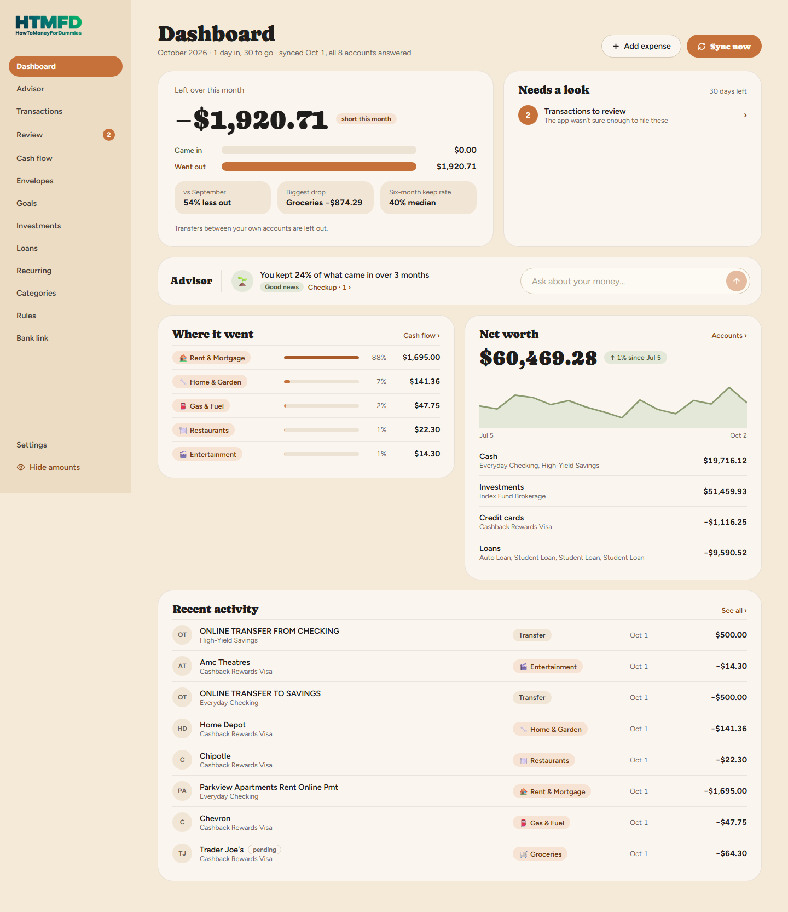
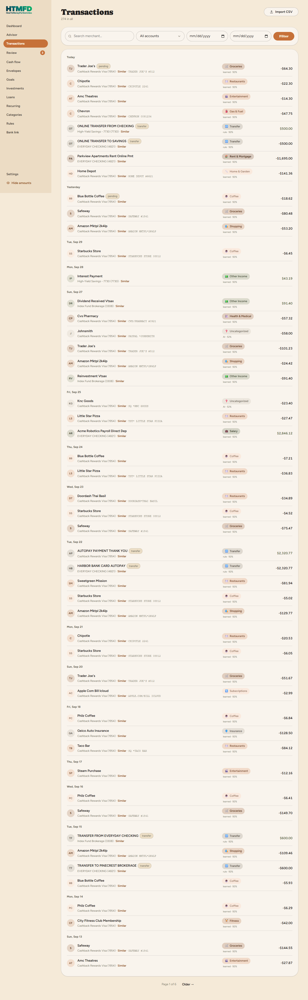
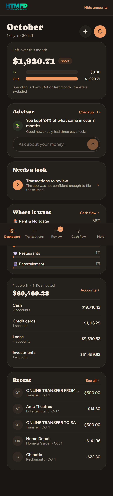

<p align="center">
  
</p>

<h1 align="center">howToMoney</h1>

<p align="center">
  A self-hosted personal finance app. Bank sync, budgets, net worth, and an AI advisor,<br>
  running on your own hardware for about $30 a year instead of $100+ for a subscription.
</p>

<p align="center">
  
</p>

---

## Why

Hosted budgeting apps are convenient, but they put your entire financial history on someone else's servers and charge a yearly subscription. howToMoney does the same job on a home server or NAS:

- **Your data stays on your hardware.** Bank access is read-only, and the credentials are stored encrypted.
- **Cheap to run.** Bank sync costs about $15/yr through SimpleFIN Bridge. AI categorization usually costs well under $0.50/month.
- **Multi-user.** Each household member gets fully separate data, enforced by the database itself.

## Features

| | |
|---|---|
| **Bank sync** | Pulls transactions automatically from SimpleFIN Bridge (Plaid also supported). Older history can be imported from CSV, OFX or QFX files, with duplicate-safe matching. |
| **Smart categorization** | Works through layers: your rules first, then remembered merchants, then Claude for merchants it has never seen. Anything it's unsure about goes to a review queue. One correction is remembered permanently. |
| **Transfer matching** | Recognizes a credit-card payment from checking as one transfer, not as spending. The matching is deterministic and needs supporting evidence before it pairs two transactions. |
| **Budgets and planning** | Envelopes (monthly spending limits), a recurring-bills calendar, savings and debt-payoff goals, and a cash-flow forecast. |
| **Wealth** | Net worth over time, every account, brokerage holdings and loan payoff schedules. |
| **Advisor** | A no-AI checkup after every sync: emergency fund, idle cash, budgets over their limit, changed bills. You can also ask questions in plain English, like *"Can I afford an $800 TV?"*. The app computes every figure from your ledger; the model only chooses which figures to look up and explains them. |
| **Privacy** | One keystroke (`h`) hides every amount on screen. Two-factor login. Alerts and a heartbeat monitor arrive by email. |

<p align="center">
  
  
</p>

## Architecture

```
                 Internet
                    │
        Cloudflare Access (identity check at the edge)
                    │  outbound-only tunnel, no open ports
┌───────────────────┼──────────────────────────────────────────┐
│ Home server / NAS ▼                       (Docker Compose)   │
│  ┌──────────────┐   ┌──────────────┐   ┌──────────────────┐  │
│  │ cloudflared  │──▶│ web          │──▶│ PostgreSQL 16    │  │
│  └──────────────┘   │ SvelteKit    │   │ row-level        │  │
│                     └──────────────┘   │ security         │  │
│  ┌──────────────┐                      │                  │  │
│  │ worker       │─────────────────────▶│                  │  │
│  │ sync, AI,    │                      └────────┬─────────┘  │
│  │ alerts       │                               │            │
│  └──────┬───────┘                      ┌────────▼─────────┐  │
│         │                              │ backup: daily,   │  │
│         │                              │ encrypted dumps  │  │
│         │                              └──────────────────┘  │
└─────────┼────────────────────────────────────────────────────┘
          ▼
  SimpleFIN / Plaid · Claude API · Cloudflare Worker (email relay)
```

| Layer | Technology |
|---|---|
| App | SvelteKit (Svelte 5), TypeScript |
| Database | PostgreSQL 16, Drizzle ORM with versioned migrations |
| Background jobs | Node worker container: sync, categorization, alerts, heartbeat |
| AI | Claude API (Anthropic SDK). Optional: `AI_PROVIDER=none` runs rules and memory only |
| Edge and access | Cloudflare Tunnel, Cloudflare Access |
| Email | Cloudflare Worker + Email Routing (`workers/feedback`) |
| Observability | Sentry (optional, off without a DSN) |
| Delivery | Docker multi-stage builds, Compose overlays for dev and prod |

## Security model

Layered, because this app holds a complete financial history:

1. **No open ports.** The server is reachable only through an outbound Cloudflare Tunnel, and Cloudflare Access rejects unknown users at the edge.
2. **The app's own login** comes second: password plus optional TOTP two-factor. There is no public sign-up route.
3. **Tenant isolation in the database.**
   - Every table has a `user_id` and a PostgreSQL row-level security policy.
   - The app connects as a restricted role, so a query that forgets to filter returns nothing.
   - `npm run test:isolation` attacks this boundary six different ways in CI.
4. **Credentials encrypted at rest.** Bank access URLs are stored with AES-256-GCM. A database dump and a copied `.env` are each useless on their own.
5. **Write-only backups.** The server encrypts each dump to a public certificate and cannot decrypt its own backups (see [`backup/`](backup/README.md)).
6. **Minimal data to the model.** The advisor sends totals, categories and merchant names, never transactions or account numbers.

## Quick start (local)

```bash
npm install
npm run setup -- --host localhost      # creates .env with generated DB password and encryption key
# add SIMPLEFIN_SETUP_TOKEN, ANTHROPIC_API_KEY (optional), SEED_EMAIL, SEED_PASSWORD to .env

docker compose -f docker-compose.yml -f docker-compose.dev.yml up -d db
npm run db:migrate && npm run db:seed
npm run simplefin:claim                # exchanges the one-time token for an encrypted access URL
AI_PROVIDER=none npm run sync:once -- 730   # free first sync to check the data
npm run dev                            # http://localhost:5173
```

**Want to look around without a bank?** `npm run demo:seed` loads a realistic demo household. All the screenshots here use it.

## Deploying

The production overlay adds the tunnel and the backup service:

```bash
docker compose -f docker-compose.yml -f docker-compose.prod.yml up -d --build
docker compose exec web npm run db:migrate
```

The full walkthrough is in **[docs/GUIDE.md](docs/GUIDE.md)**. It covers:
- Synology/NAS deployment
- the Cloudflare Tunnel and Access setup, including how to *verify* Access from outside
- importing history from CSV, OFX and QFX files
- multi-user setup, backups, and every feature in detail

## Testing and CI

GitHub Actions runs on every push and pull request:

| Job | What it checks |
|---|---|
| **Check** | `svelte-check` type checking, unit tests (CSV/OFX parsing, crypto, loans, advisor, health, Plaid mapping), and `npm audit` for high-severity production vulnerabilities |
| **Database** | Against a real PostgreSQL service: row-level-security isolation tests, password rules, and transaction matching/de-duplication smoke tests |
| **End-to-end** | Builds the app, seeds the demo household, and runs Playwright: page coverage, accessibility, phone layouts, and checks that every total adds up to the transactions it links to |

To run them locally: `npm run check`, `npm test`, and `npm run test:e2e`.

## Project structure

```
├── src/
│   ├── routes/          # SvelteKit pages and API endpoints
│   └── lib/server/      # sync, categorization, advisor, auth, DB schema
├── scripts/             # setup, migrations, sync worker, tests
├── drizzle/             # versioned SQL migrations
├── workers/feedback/    # Cloudflare Worker: email relay + heartbeat monitor
├── backup/              # encrypted daily backup service
├── e2e/                 # Playwright suite
└── docs/                # full guide and screenshots
```

## License

MIT. See [LICENSE](LICENSE).
